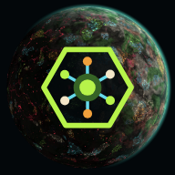
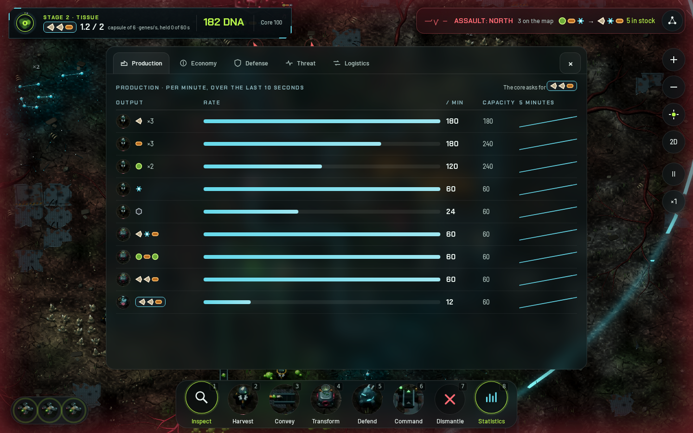

<p align="center"></p>

<h1 align="center">Strainworks</h1>

<p align="center"><b>Write the living. Make it a factory. Survive its mutations.</b></p>

<p align="center">
  
  
  
  
</p>

<h3 align="center"><a href="https://strainworks.onrender.com">▶ Play now at strainworks.onrender.com</a></h3>
<p align="center">No install, no account. On a desktop or a phone, installable and playable offline.</p>

<p align="center"></p>

You run a station that industrializes life. You mine organic bases, splice them into genes, weave the genes
into DNA and feed it to a hungry core. Out in the fog, the breaches you woke send creatures built from the
very code you manufacture. Your only real weapon is their exact opposite.

Zoom out and the belts start to pulse like veins. **It was never a factory. It was a creature.**

A factory game crossed with tower defense, in the browser and on the phone, in English and French.

---

## Why it is different

- **Your ammunition is a recipe.** Every wave carries a gene, and only the opposite gene hurts it. Turrets
  fire whatever you feed them, so winning means building the right line, not the biggest gun.
- **The factory has a nervous system.** Radar pylons sense creatures or nests, the core says what it asks for,
  nerves carry it, and sorters, gates, Ligases and joiners switch your lines to the right gene by themselves.
- **The enemy evolves.** From stage 4 a new family is born every five minutes. The lines you built for the
  old ones still have to hold.
- **Every game has its own genes.** Each game draws three base genes the core feeds on all along; every stage's
  recipe is built on them, so what you build early keeps serving, and the core's panel draws each recipe for you.
- **The core grows.** Six stages, from Cellule to Éclosion, each asking for a mechanic you already have and
  opening new machines and defences, richer deposits and longer logistics: maglev worms that haul like trains,
  veins that pump, isotope far out in the dark.
- **The threat comes to you.** From stage 2, announced swarms march on the base, growing with time and with
  what you build, with a quiet minute after each one you clear; nests guard the richest deposits and pay well
  when they fall.
- **Every threat has its answer.** Turrets, stings and maws, a glue pool that slows, a mister for swarms, a
  harpoon that runs through a titan, all in three ranks.
- **Nothing appears by magic.** Drones fly to every site, build it, dismantle it, repair it. You watch them work.


## A small planet of games

Every game is a hexagon on an infected planet that heals as you play. Hatching a strain purifies its hexagon for
good and opens its neighbours; each hatching lets you keep one of three strain mutations for every later station,
each ring farther out is harder, and purifying a whole region, a hexagon and all its neighbours, is the grand
victory. Pick a game up where you left it, export it,
copy it, share it as a file. A demo hexagon opens a stage 6 base that runs by itself, fresh every time, in the middle of a fight.
The game installs as an app and plays offline, in 2D or in 3D with a
small-planet curvature, on a desktop or a phone.

<p align="center">
  
  
</p>

<p align="center"></p>

## Play

In your browser: **[strainworks.onrender.com](https://strainworks.onrender.com)**.

Or locally:

```sh
npm install
npm run dev
```

The browser opens the prototype. That is all it takes.

The full design, every decision and its reasons, is in the [concept](docs/concept.md). What changed, version by
version, is in the [changelogs](changelogs/README.md).

---

<details>
<summary><b>For developers</b>: running, performance, build, tests and layout</summary>

### Run the prototype

```sh
npm install
npm run dev
```

The browser opens `/prototype/`. The transport mockup is at `/prototype/transports/`. The page loads the game from `src/` as modules, so it runs through Vite (`npm run dev`) or from the built site (`npm run build`, then `npm run preview`), not as a file opened directly.

A game opens in 3D, drawn with Babylon.js, unless the player picked 2D in the settings. The prototype fetches the engine from jsDelivr on first use (the built site serves its own copy), pinned by version and SHA-384, and the game stays in 2D when it cannot load. The version and the hash are written at build from the installed `babylonjs` package (`scripts/babylon-pin.mjs`): bumping the package is the only edit, and a test compares the page with it.

### The model lab

`?lab` after the game's address (`/prototype/?lab` in development) opens a dev page: every 3D model alone on clean
ground, buildings, creatures, nests and drones. A panel turns, ranks, mirrors or damages the one shown and shows its
whole state as JSON, editable. The clock runs so models move, the rules stand still, and nothing is saved.

### Performance

Settings > **Graphe de performance** shows 30 s of what each frame costs on the main thread, by kind
(simulation, fog, 2D drawing, 3D view, interface, save), with the real time between frames and the
60 and 30 images a second lines. In 3D a cyan line shows the GPU time of a frame where the browser can
time it, and says so where it cannot. Hidden, nothing is measured. Settings > **Qualité 3D** > Rapide
draws the 3D view in screen pixels with smaller shadows and a lighter glow.

### Build the site

```sh
npm run build
npm run preview   # http://127.0.0.1:4173
```

An installable static site that plays offline. Deployment follows a published release: see [static site and releases](docs/static-site.md).

### Check

```sh
npx playwright install chromium   # once
npm run check
```

`npm test` replays the prototype in headless Chromium: belt motion, carbon and containers, sorters, bridges, gates, deposits and veins, breaches and damage, economy, construction by drone, dismantling and repair, the endless map, the preview under the pointer, worms, progression, nerves and the 3D view. Each run is seeded and compared with the recorded results in `tests/prototype/__snapshots__/`, and saves from earlier prototype versions must still load.

When a rule changes on purpose, rerun with `npm test -- -u` and read the snapshot diff before committing it: that diff is the gameplay change.

`npm run playthrough` plays fresh drawn games in the browser through the game's own tools, up to the hatching, and
prints a JSON line a seed: each stage's asks, time, DNA, losses and errors. It runs on demand, outside `npm test`.

The test browser draws WebGL with SwiftShader, on the CPU. On WSL2 with a GPU driver, `STRAINWORKS_GPU=1` makes it
render WebGL through Mesa's D3D12 backend (ANGLE over EGL) instead, and `tests/prototype/gpu.test.mjs` checks once a
run that it does. CI leaves it unset.

### Layout

| Path | Content |
|---|---|
| `prototype/` | The playable prototype, its 3D view (`view3d.js`, models in `models3d.js`, ground in `terrain3d.js`) and the transport mockup, in English and French |
| `docs/design/interface/` | Approved mockup of the interface |
| `docs/concept.md` | Game concept and decisions |
| `docs/media/` | README images and clips |
| `tests/prototype/` | Behavior tests of the prototype |
| `tests/fixtures/saves/` | Saved games from earlier prototype versions |
| `site/`, `scripts/` | The static site: service worker, manifest, icons, build |
| `src/` | The game as modules: the simulation in `src/sim/` (no DOM, tested in Node under `tests/sim/`), the interface in `src/game/` |
| `logics/` | Workflow corpus |

</details>

## License

[MIT](LICENSE). What the repository holds was checked before it turned public: see
[public readiness](docs/public-readiness.md).
