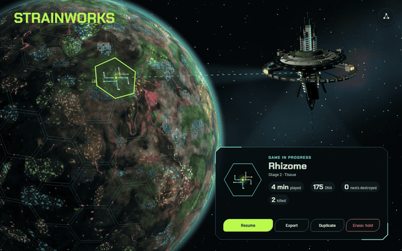
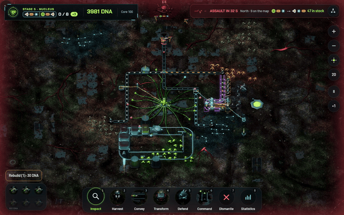

<p align="center"></p>

<h1 align="center">Strainworks</h1>

<p align="center"><b>Write the living. Make it a factory. Survive its mutations.</b></p>

<p align="center">
  
  
  
  
</p>

<h3 align="center"><a href="https://strainworks.onrender.com">▶ Play now at strainworks.onrender.com</a></h3>
<p align="center">No install, no account. On a desktop or a phone, installable and playable offline.</p>

<p align="center"></p>

You run a station that industrializes life. You mine organic bases, splice them into genes, weave the genes
into DNA and feed it to a hungry core. Out in the fog, the breaches you woke send creatures built from the
very code you manufacture. Your only real weapon is their exact opposite.

Zoom out and the belts start to pulse like veins. **It was never a factory. It was a creature.**

A factory game crossed with tower defense, in the browser and on the phone, in English and French.

---

## Why it is different

- **Your ammunition is a recipe.** Every wave carries a gene, and only the opposite gene hurts it. Turrets
  fire whatever you feed them, so winning means building the right line, not the biggest gun.
- **The factory has a nervous system.** Radar pylons sense what is coming, nerves carry it, and sorters and
  gates switch your lines to the antidote the moment a wave shows up.
- **The enemy evolves.** From stage 4 a new family is born every five minutes. The lines you built for the
  old ones still have to hold.
- **The core grows.** Five stages, from Cellule to Noyau, each opening new machines, richer deposits and longer
  logistics: worms that haul like trains, veins that pump, isotope far out in the dark.
- **Nothing appears by magic.** Drones fly to every site, build it, dismantle it, repair it. You watch them work.


## A small planet of games

Every game is a hexagon on a living planet that fills up as you play. Pick one up where you left it, export it,
copy it, share it as a file. The game installs as an app and plays offline, in 2D or in 3D with a
small-planet curvature, on a desktop or a phone.

<p align="center">
  
  
</p>

<p align="center"></p>

## Play

In your browser: **[strainworks.onrender.com](https://strainworks.onrender.com)**.

Or locally:

```sh
npm install
npm run dev
```

The browser opens the prototype. That is all it takes.

The full design, every decision and its reasons, is in the [concept](docs/concept.md). What changed, version by
version, is in the [changelogs](changelogs/README.md).

---

<details>
<summary><b>For developers</b>: running, performance, build, tests and layout</summary>

### Run the prototype

```sh
npm install
npm run dev
```

The browser opens `/prototype/`. The transport mockup is at `/prototype/transports/`. `prototype/index.html` also opens directly as a file, with `view3d.js`, `models3d.js` and `terrain3d.js` beside it.

A game opens in 3D, drawn with Babylon.js, unless the player picked 2D in the settings. The prototype fetches the engine from jsDelivr on first use (the built site serves its own copy), pinned by version and SHA-384, and the game stays in 2D when it cannot load. After changing that version, update the hash in `prototype/index.html`: a test compares it with the installed package.

### The model lab

`?lab` after the game's address (`/prototype/?lab` in development) opens a dev page: every 3D model alone on clean
ground, buildings, creatures, nests and drones. A panel turns, ranks, mirrors or damages the one shown and shows its
whole state as JSON, editable. The clock runs so models move, the rules stand still, and nothing is saved.

### Performance

Settings > **Graphe de performance** shows 30 s of what each frame costs on the main thread, by kind
(simulation, fog, 2D drawing, 3D view, interface, save), with the real time between frames and the
60 and 30 images a second lines. In 3D a cyan line shows the GPU time of a frame where the browser can
time it, and says so where it cannot. Hidden, nothing is measured. Settings > **Qualité 3D** > Rapide
draws the 3D view in screen pixels with smaller shadows and a lighter glow.

### Build the site

```sh
npm run build
npm run preview   # http://127.0.0.1:4173
```

An installable static site that plays offline. Deployment follows a published release: see [static site and releases](docs/static-site.md).

### Check

```sh
npx playwright install chromium   # once
npm run check
```

`npm test` replays the prototype in headless Chromium: belt motion, carbon and containers, sorters, bridges, gates, deposits and veins, breaches and damage, economy, construction by drone, dismantling and repair, the endless map, the preview under the pointer, worms, progression, nerves and the 3D view. Each run is seeded and compared with the recorded results in `tests/prototype/__snapshots__/`, and saves from earlier prototype versions must still load.

When a rule changes on purpose, rerun with `npm test -- -u` and read the snapshot diff before committing it: that diff is the gameplay change.

### Layout

| Path | Content |
|---|---|
| `prototype/` | The playable prototype, its 3D view (`view3d.js`, models in `models3d.js`, ground in `terrain3d.js`) and the transport mockup, in English and French |
| `docs/design/interface/` | Approved mockup of the interface |
| `docs/concept.md` | Game concept and decisions |
| `docs/media/` | README images and clips |
| `tests/prototype/` | Behavior tests of the prototype |
| `tests/fixtures/saves/` | Saved games from earlier prototype versions |
| `site/`, `scripts/` | The static site: service worker, manifest, icons, build |
| `src/` | The product. Empty until the simulation is ported |
| `logics/` | Workflow corpus |

</details>

## License

[MIT](LICENSE). What the repository holds was checked before it turned public: see
[public readiness](docs/public-readiness.md).
