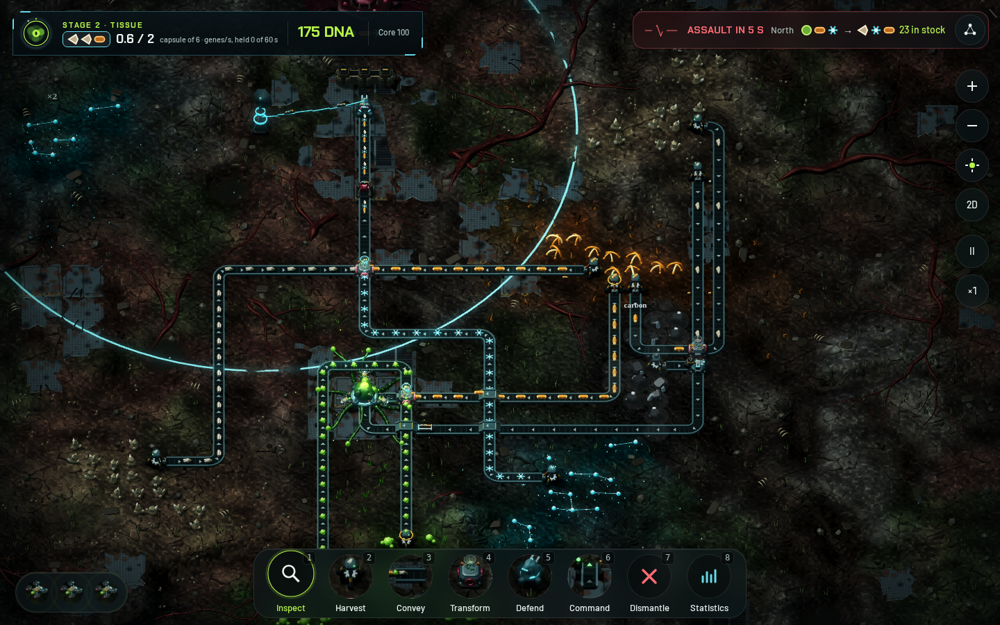
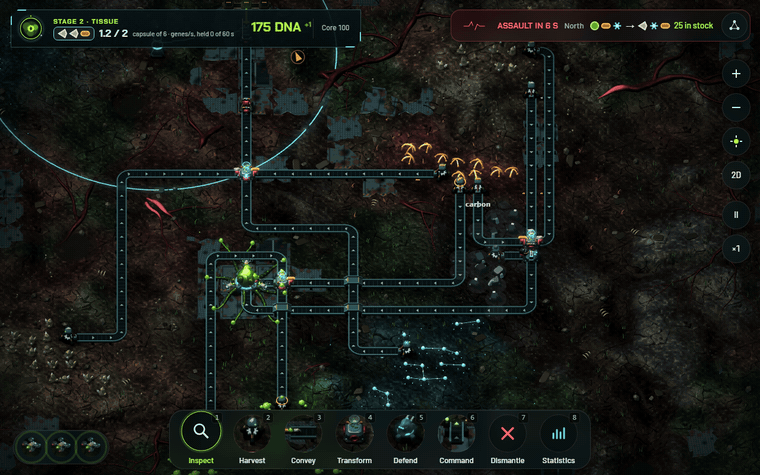
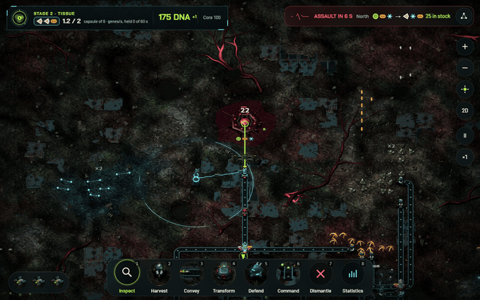
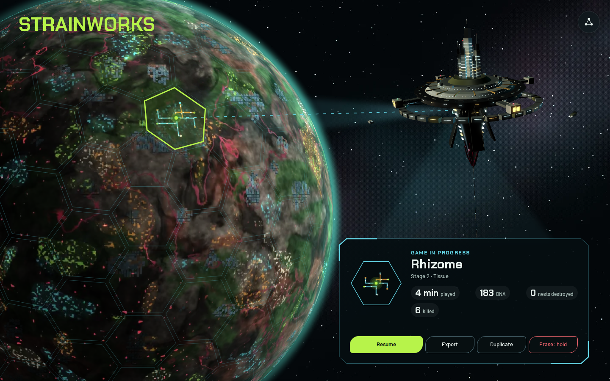

# Strainworks

<br clear="left"/>


**Write the living. Make it a factory. Survive its mutations.**

A factory game crossed with tower defense, for the browser and the phone. The interface is in French.

Version `0.1.0`, a playable prototype. See the [concept](docs/concept.md) and the [changelogs](changelogs/README.md).



---

## A factory that writes DNA

Four organic bases lie in deposits around a hungry core: Spore, Fibre, Chitine and Nerf. Harvesters pull
them out, belts carry them, and a Ligase joins three of them, in order, into a gene. Assemblers join genes
into strands, the Encapsulator packs them with carbon into capsules and magazines.

The core asks for one product at a time. Feed it and the organism grows through five stages, from Cellule to
Noyau, each one opening new machines, richer deposits and longer logistics.



## Fight a gene with its opposite

Breaches sleep in the fog. Build near one and it wakes; every wave carries a gene, and only the opposite
gene hurts it. Turrets fire whatever they are fed, so the factory has to make the right ammunition at the
right time: sorters and gates, wired by nerves to turrets and radar pylons, switch the lines to the antidote
the moment a wave shows up. Nests have hit points: destroy them, or their wave comes back.

From stage 4 the creatures mutate: a new family is born every five minutes, and the lines built for the
old ones still have to hold.



## What is in the prototype

- **Build** with drones: harvesters, belts, bridges, splitters, sorters, gates, ligases, assemblers,
  encapsulators, cysts and vaults, pumps and veins, trails, pockets and worms, turrets, stings, maws and
  walls, each with MK ranks.
- **Command**: nerves link turrets, radar pylons, gates and sorters into one net that follows the threat.
- **Read it**: a Statistics sheet with production, ADN, defense, threat and what slows the factory; touch a
  problem and the camera goes there.
- **Explore**: an endless map in levels, fog that lifts around what you build, isotope far out.
- **See it** in 2D or 3D, with a small-planet curvature, on a desktop or a phone, offline once installed.
- **Keep it**: games live on a planet of hexagons, saved in the browser, exported and imported as files.




## Run the prototype

```sh
npm install
npm run dev
```

The browser opens `/prototype/`. The transport mockup is at `/prototype/transports/`. `prototype/index.html` also opens directly as a file, with `view3d.js`, `models3d.js` and `terrain3d.js` beside it.

A game opens in 3D, drawn with Babylon.js, unless the player picked 2D in the settings. The prototype fetches the engine from jsDelivr on first use (the built site serves its own copy), pinned by version and SHA-384, and the game stays in 2D when it cannot load. After changing that version, update the hash in `prototype/index.html`: a test compares it with the installed package.

## Performance

Settings > **Graphe de performance** shows 30 s of what each frame costs on the main thread, by kind
(simulation, fog, 2D drawing, 3D view, interface, save), with the real time between frames and the
60 and 30 images a second lines. In 3D a cyan line shows the GPU time of a frame where the browser can
time it, and says so where it cannot. Hidden, nothing is measured. Settings > **Qualité 3D** > Rapide
draws the 3D view in screen pixels with smaller shadows and a lighter glow.

## Build the site

```sh
npm run build
npm run preview   # http://127.0.0.1:4173
```

An installable static site that plays offline. Deployment follows a published release: see [static site and releases](docs/static-site.md).

## Check

```sh
npx playwright install chromium   # once
npm run check
```

`npm test` replays the prototype in headless Chromium: belt motion, carbon and containers, sorters, bridges, gates, deposits and veins, breaches and damage, economy, construction by drone, dismantling and repair, the endless map, the preview under the pointer, worms, progression, nerves and the 3D view. Each run is seeded and compared with the recorded results in `tests/prototype/__snapshots__/`, and saves from earlier prototype versions must still load.

When a rule changes on purpose, rerun with `npm test -- -u` and read the snapshot diff before committing it: that diff is the gameplay change.

## Layout

| Path | Content |
|---|---|
| `prototype/` | The playable prototype, its 3D view (`view3d.js`, models in `models3d.js`, ground in `terrain3d.js`) and the transport mockup, French interface |
| `docs/design/interface/` | Approved mockup of the interface |
| `docs/concept.md` | Game concept and decisions |
| `docs/media/` | README images and clips |
| `tests/prototype/` | Behavior tests of the prototype |
| `tests/fixtures/saves/` | Saved games from earlier prototype versions |
| `site/`, `scripts/` | The static site: service worker, manifest, icons, build |
| `src/` | The product. Empty until the simulation is ported |
| `logics/` | Workflow corpus |

## License

[MIT](LICENSE). What the repository holds was checked before it turned public: see
[public readiness](docs/public-readiness.md).
