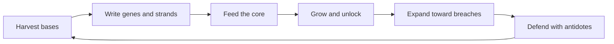

## prod_001_strainworks - Strainworks
> Date: 2026-11-22
> Status: Proposed
> Related request: `req_000_turn_the_validated_strainworks_prototype_into_a_game`
> Related backlog: `item_001_keep_the_playable_prototype_and_play_test_its_core_loop`, `item_002_port_the_simulation_with_equal_behavior`, `item_003_render_the_shared_simulation_in_3d`
> Related task: `task_001_orchestrate_the_path_from_prototype_to_game`
> Related architecture: (none yet)
> Reminder: Update status, linked refs, scope, decisions, success signals, and open questions when you edit this doc.

# Overview
An incremental factory and tower defense game for browser and mobile where the player writes living strands of DNA, feeds a growing organism, and counters each creature with the opposite of its gene.

# Goals
- Producing is satisfying on its own, and defense puts that goal at risk.
- The order and routing of bases stay the player's puzzle.
- The factory reads at three zoom levels on a phone.

# Non-goals
- Machines that change recipe by themselves.
- Maturation of items on belts.
- A business model before the loop is proven fun.

# Scope and guardrails
- In: scaffolded request, product, backlog, orchestration task, validation, and handoff context.
- Out: unrelated workflow docs and implementation of generated tasks.

# Key product decisions
- Use structured input as the source of truth for generated docs.
- Keep generated write paths local and repo-bounded.

# Success signals
- Generated docs pass lint and audit without broad manual rewrites.
- Context-pack output can be handed to an implementation agent directly.

# References
- Product back-reference: `req_000_turn_the_validated_strainworks_prototype_into_a_game`
- Task back-reference: `task_001_orchestrate_the_path_from_prototype_to_game`
